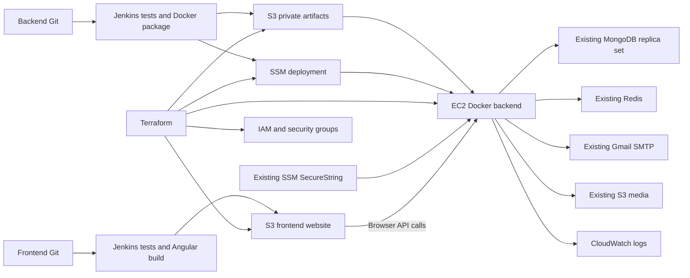

# Final verification report — password recovery, Jenkins and AWS

> **Hosting superseded (2026-10-26):** the S3 website and direct HTTP EC2 endpoint described below were replaced by Vercel HTTPS and Caddy HTTPS on EC2. See the backend `docs/https-vercel-migration.md`. This report remains the record of the earlier verification.

Recorded: 2026-10-25T21:43:37-06:00 (America/Guatemala). No commit, push, Terraform apply/destroy or AWS deployment was performed.

## A. Authentication audit

Express 5.2/CommonJS, Mongoose 9.10, Redis client 6.2, bcryptjs, Nodemailer; Angular 21.2/TypeScript 5.9/Tailwind 4. Existing email/password login returns a four-hour JWT immediately; the verification screen follows registration in this checkout. Therefore the task premise of a normal-login OTP was checked and corrected against actual source. Existing code helper uses eight numeric digits, purposes `2fa` and `reset`, `${type}:${email}` storage and 900-second TTL. Existing Gmail sender and LuminaBeauty HTML are reused. Password hashing remains bcrypt cost 10; password policy remains minimum four characters. Existing session revocation is absent.

The original map was saved before implementation in backend `docs/auth-deployment-audit.md`. Existing order/report changes in both repositories were preserved.

## B. Recovery architecture

Request normalizes email, enforces Redis limits and returns the same acknowledgement for existing/missing/disabled/Google-only accounts. The shared helper sends the branded recovery email and stores a code digest for 15 minutes. Verify consumes only the `reset` code atomically; five failed attempts lock the window. It creates a 32-byte opaque authorization valid five minutes, stored under a token digest and bound to user ID plus old password hash. Reset validates the existing password policy and confirmation, consumes authorization with GETDEL, hashes with bcrypt and conditionally updates that exact account/old hash. This blocks forged identity, replay and competing authorizations. Current code is deleted. Old password fails and new password succeeds in real login tests.

Limits: 30-second resend cooldown, five sends/account/hour, 30 requests/IP/hour. A 500 ms response floor reduces the missing-account fast path; external SMTP latency can still vary. Existing JWTs are not revoked and may last four hours. These are documented limitations, not unimplemented revocation claims.

## C. Frontend implementation

- `/auth/login`: real “¿Olvidaste tu contraseña?” router link and post-reset success notice.
- Lazy `/auth/restore`: identifier → eight-digit verification/resend → new password/confirmation.
- Reactive forms, signals, loading protection, focus movement, visible API errors, back/restart, memory-only authorization.
- Existing card/colors/spacing/alerts/FormUtils; existing password mismatch validator and shared error parser. Registration frontend minimum aligned from 3 to backend's 4.
- Production configuration now replaces both existing environment imports and generates only public config from PUBLIC_API_URL.

Files: `src/app/auth/pages/restore-password-page/*`, `src/app/auth/services/password-recovery.service.ts`, auth routes/login/layout, registration validator, shared parser, `ci/*`, `angular.json` and `package.json`.

## D. Backend implementation

Routes under `/api/auth`: `POST /password/request`, `/password/verify`, `/password/reset`. `/request-code` with `type=reset` delegates to the protected request flow; `/password/verify-reset` returns 410 to prevent bypassing the new authorization. Express-validator handles typed email/code/token/password/confirmation checks and the existing `{ok:false,msg}` convention.

Files: `controllers/password-recovery.controller.js`, `routes/auth.route.js`, `helpers/db-redis-codes.js`, `helpers/email-generator.js`, `config/mailer.js`, `controllers/auth.controller.js`. Shared Redis/email protections serve existing `2fa` too. Redis connection strings and OAuth tokens are no longer logged. The fixed placeholder password for new Google accounts is replaced with a random value. `helpers/s3.js` uses the default AWS credential chain, enabling EC2 roles. `/api/health` verifies MongoDB/Redis readiness and returns APP_VERSION; CORS exposes Retry-After.

## E. Security proof

The backend recovery suite includes 20 real-service subtests: request/email/digest/TTL; generic missing/disabled/Google responses; email normalization and compatibility route; cooldown; invalid code/remaining attempts; valid authorization TTL; code replay; password policy/confirmation; cross-account forgery; old/new login passwords; token replay/verified=true forgery; real TTL code expiry; both wrong-purpose directions; authorization expiry; concurrent code consumption; competing authorizations; attempt lockout surviving resend; hourly budget; bad DTOs/retired endpoint; health/readiness/version.

Chrome E2E uses actual compiled Angular, Express routes, isolated real MongoDB/Redis and a local SMTP capture server. All **12 required user steps passed**, plus **3 axe checks including contrast** and **2 mobile/desktop overflow checks**: 17 checks, 0 failures. Code comes from actual SMTP delivery, not from an API mock or manually invented code. Observed reset authorization and code are replayed and rejected. Screenshot was reviewed at `/tmp/lumina-recovery-browser.png`. Sanitized persisted evidence: `docs/verification-evidence.json`.

Secret-pattern scan of tracked and untracked source found no literal AWS access keys, private keys or JWTs. Neither repository tracks .env, Terraform state or dist output. No production secrets were added or committed. This is a source/pattern check, not a claim of a complete historical credential audit.

## F. Backend Jenkins pipeline

Root Jenkinsfile: checkout → runtime → npm ci → full suite → Terraform fmt/init/validate/mock test → production Docker build → archive/checksum verification → protected main + DEPLOY plan → private S3 release → constrained SSM command → EC2 health/version.

Actual local npm ci, tests, image build, non-root/entrypoint checks and Docker archive packaging passed. Runtime and deployment Bash/Python syntax checks passed. The remote plan uses detailed exit codes: any drift or error prevents application deployment. No automatic apply/destroy. Deployment identity comes from `lumina-aws-deploy`; state/variables use Jenkins secret files. The server gets environment values directly from an existing SSM SecureString using its role.

## G. Frontend Jenkins pipeline

Checkout → runtime → npm ci → full suite → production build → verify/package **dist/luminabeauty-app/browser** → protected main + DEPLOY S3 sync → HTTP hash/MIME verification. AWS binding ID: `lumina-aws-frontend`. PUBLIC_API_URL is public configuration; no backend secrets enter the build.

S3 publishes assets before index, uses explicit HTML/JSON types, no-store entrypoint and immutable hashed JS/CSS, then removes stale objects from the dedicated frontend bucket. Local verification checked index plus seven HTML references; the deployment-verifier script also passed against a local static server for index/revision and **32 JS/CSS files**. This local test is not live S3 proof.

Both Jenkinsfiles passed Groovy parsing. Real Jenkins Declarative/plugin validation and actual pipeline execution are **BLOCKED**: no controller is configured. Failures propagate through sequential stages and set-e scripts. main exists and is origin's default in both repos; develop/features/PRs cannot deploy through the configured conditions. Trusted deployment credential/job separation is documented.

## H. AWS IaC

One Terraform stack in backend `infra/terraform`: existing VPC/public subnet reference; EC2 with encrypted root and IMDSv2; no SSH ingress; explicit HTTP client CIDRs only; specified database/Redis egress; Docker/SSM bootstrap; CloudWatch logs; instance profile; named-parameter/release/media/log permissions; constrained SSM deployment document; separate website and private artifact S3 buckets with encryption/versioning/ownership controls; Jenkins role policies as outputs. No new MongoDB/Redis, domain or CloudFront.

Remote S3 backend is partial configuration, with private bootstrap bucket, encryption, versioning and lockfile documented. Actual tfvars/backend config/state/plans are ignored; provider lockfile is reviewable. AMI strategy, region, environment, type, container port, bucket names, CIDRs, parameter reference and tags are variables. Outputs contain resource IDs/URLs/policy ARNs, not secret values.

## I. AWS architecture



## J. IaC validation

| Check | Result |
|---|---|
| Terraform fmt -check -recursive | PASS |
| Terraform init -backend=false | PASS |
| Terraform validate | PASS |
| Terraform test: mocked plan | PASS — 1 test, 6 assertions; no AWS resources |
| Real terraform plan | BLOCKED — invalid AWS credentials and no real environment inputs/state bootstrap |
| Apply | NOT RUN |
| Destroy | NOT RUN |

Terraform 1.13.5; locked AWS provider 6.70.0. The mocked plan is explicitly not counted as a real AWS plan.

## K. Deployment proof

Local Docker image and packaged artifact passed build/integrity checks. The actual health route passed against local MongoDB/Redis and returned the expected QA revision. Live EC2 existence/service/health/deployed revision: **BLOCKED**. Live S3 current build/index/assets/backend configuration: **BLOCKED**. AWS STS identity check returned **InvalidClientTokenId**. No remote write/deploy was attempted. Jenkins execution: **BLOCKED**, no configured controller.

HTTPS/domain remains a separate production prerequisite: the deliberately chosen S3 website endpoint and direct EC2 HTTP endpoint do not provide TLS. No claim of production readiness or zero downtime is made. The project also has inherited dependency advisories: backend 6 (4 moderate/2 high); frontend 16 (5 moderate/9 high/2 critical). No forced unrelated upgrades were applied.

## L. Fresh tests and builds

| Verification | Result |
|---|---|
| Backend full suite, Node 22 | **70 passed, 0 failed, 0 skipped** |
| Frontend full suite, Node 22 | **249 passed, 24 files, 0 failed** |
| Chrome real browser recovery | **12/12 scenario steps**, plus 5 accessibility/layout checks |
| Frontend production build | PASS; 511.00 kB initial, warning threshold 500 kB, error threshold 1 MB |
| Frontend package/reference checks | PASS; index + 7 referenced assets |
| Frontend local HTTP verifier | PASS; index/release + 32 JS/CSS files |
| Backend production Docker package | PASS; non-root entrypoint, gzip and SHA-256 checks |
| Both Jenkinsfiles Groovy syntax | PASS; actual Jenkins execution BLOCKED |
| Bash/Python deployment script syntax | PASS |
| Terraform validation/security test | PASS; 1 mock plan test / 6 assertions |

Build still reports an existing unused CurrencyPipe warning. Tests and browser results are fresh executions, not inferred from code inspection. Local image/release labels use the current HEAD as a packaging check on the dirty working tree; this is not a claim that HEAD alone reproduces uncommitted changes.

## M. Git status

The following snapshots include **all existing user changes**, not just this task. No staged changes, commit or push was created. Full modified/deleted and untracked paths follow; `git diff --stat` excludes untracked file content by Git's normal behavior.

### Backend

Branch: `develop`. HEAD: `fcb25e47481c184a900b0a7ee7132664f397b9c9`. Modified tracked: 18; deleted tracked: 1; untracked files: 48.

```text
 M .dockerignore
 M .gitignore
 M Dockerfile
 M README.md
 M config/mailer.js
 M controllers/auth.controller.js
 M controllers/uploads.controller.js
 M database/config-redis.js
 M docker-compose.yml
 M helpers/db-redis-codes.js
 M helpers/db-validators.js
 M helpers/email-generator.js
 M helpers/s3.js
 M models/index.js
 M models/server.js
 M package-lock.json
 M package.json
 M routes/auth.route.js
 D routes/upload.route.js
?? Jenkinsfile
?? ci/build.sh
?? ci/check-runtime.sh
?? ci/deploy.py
?? ci/deploy.sh
?? controllers/address.controller.js
?? controllers/orders.controller.js
?? controllers/password-recovery.controller.js
?? controllers/reports.controller.js
?? docs/auth-deployment-audit.md
?? docs/password-recovery-cicd-aws.md
?? docs/verification-evidence.json
?? docs/verification-report.md
?? helpers/order-emails.js
?? helpers/order-serializer.js
?? helpers/order-service.js
?? helpers/order-states.js
?? helpers/reports/dashboard.js
?? helpers/reports/data.js
?? helpers/reports/dates.js
?? helpers/reports/filters.js
?? helpers/reports/index.js
?? helpers/reports/labels.js
?? helpers/reports/pdf.js
?? helpers/reports/xlsx.js
?? infra/terraform/.terraform.lock.hcl
?? infra/terraform/backend.hcl.example
?? infra/terraform/bootstrap.sh
?? infra/terraform/deploy.sh.tftpl
?? infra/terraform/jenkins-iam.tf
?? infra/terraform/main.tf
?? infra/terraform/outputs.tf
?? infra/terraform/storage.tf
?? infra/terraform/terraform.tfvars.example
?? infra/terraform/tests/security.tftest.hcl
?? infra/terraform/variables.tf
?? infra/terraform/versions.tf
?? migrations/20261024101500-orders-and-addresses.js
?? models/address.js
?? models/order.js
?? qa/recovery-browser.js
?? qa/recovery-fixture.js
?? routes/address.route.js
?? routes/admin.route.js
?? routes/orders.route.js
?? test/orders.test.js
?? test/password-recovery.test.js
?? test/reports.test.js
```

Diff summary (tracked files):

```text
 .dockerignore                     |    9 +
 .gitignore                        |   13 +-
 Dockerfile                        |   26 +-
 README.md                         |    3 +
 config/mailer.js                  |    5 +-
 controllers/auth.controller.js    |   55 +-
 controllers/uploads.controller.js |  188 +---
 database/config-redis.js          |    4 +-
 docker-compose.yml                |    1 +
 helpers/db-redis-codes.js         |   89 +-
 helpers/db-validators.js          |   10 +-
 helpers/email-generator.js        |  459 +-------
 helpers/s3.js                     |    5 +-
 models/index.js                   |    6 +-
 models/server.js                  |   27 +-
 package-lock.json                 | 2197 ++++++++++++++++++++++++++++++++++++-
 package.json                      |    2 +
 routes/auth.route.js              |   21 +-
 routes/upload.route.js            |   86 --
 19 files changed, 2327 insertions(+), 879 deletions(-)
```

### Frontend

Branch: `develop`. HEAD: `808ae0fb8e4881348e3b6aad00e1197995f069f3`. Modified tracked: 33; deleted tracked: 14; untracked files: 43.

```text
 M .gitignore
 M README.md
 M angular.json
 M package.json
 M src/app/admin/admin-dashboard.routes.ts
 D src/app/admin/components/sell-admin-card/sell-admin-card.component.html
 D src/app/admin/components/sell-admin-card/sell-admin-card.component.ts
 D src/app/admin/components/sell-admin-empty-state/sell-admin-empty-state.component.ts
 D src/app/admin/components/sell-admin-filters/sell-admin-filters.component.html
 D src/app/admin/components/sell-admin-filters/sell-admin-filters.component.ts
 D src/app/admin/components/sell-admin-loading-state/sell-admin-loading-state.component.ts
 D src/app/admin/interfaces/stats.interface.ts
 M src/app/admin/layouts/admin-dashboard-layout/admin-dashboard-layout.component.ts
 M src/app/admin/pages/admin-dashboard/admin-dashboard.html
 M src/app/admin/pages/admin-dashboard/admin-dashboard.ts
 D src/app/admin/pages/sell-admin-page/sell-admin-page.component.html
 D src/app/admin/pages/sell-admin-page/sell-admin-page.component.ts
 D src/app/admin/pages/sells-admin-page/sells-admin-page.component.html
 D src/app/admin/pages/sells-admin-page/sells-admin-page.component.ts
 D src/app/admin/services/sell-finished.service.ts
 D src/app/admin/services/stats.service.ts
 M src/app/auth/auth.routes.ts
 M src/app/auth/layouts/auth-layout/auth-layout.component.html
 M src/app/auth/pages/login-page/login-page.component.html
 M src/app/auth/pages/login-page/login-page.component.ts
 M src/app/auth/pages/register-page/register-page.component.ts
 M src/app/auth/pages/restore-password-page/restore-password-page.component.html
 M src/app/auth/pages/restore-password-page/restore-password-page.component.ts
 M src/app/shared/components/confirm-dialog/confirm-dialog.component.ts
 M src/app/shared/services/notification.service.ts
 D src/app/store-front/interfaces/checkout-payload.interface.ts
 M src/app/store-front/pages/cart-page/cart-page.spec.ts
 M src/app/store-front/pages/cart-page/cart-page.ts
 M src/app/store-front/pages/check-out-page/check-out-page.component.html
 M src/app/store-front/pages/check-out-page/check-out-page.component.ts
 M src/app/store-front/pages/check-out-page/components/checkout-order-summary/checkout-order-summary.component.html
 M src/app/store-front/pages/check-out-page/components/checkout-payment-card/checkout-payment-card.component.html
 M src/app/store-front/pages/check-out-page/components/checkout-payment-card/checkout-payment-card.component.ts
 M src/app/store-front/pages/order-page/order-page.html
 M src/app/store-front/pages/order-page/order-page.ts
 M src/app/store-front/pages/orders-page/orders-page.component.html
 M src/app/store-front/pages/orders-page/orders-page.component.ts
 M src/app/store-front/services/store-front.spec.ts
 M src/app/store-front/services/store-front.ts
 M src/app/store-front/store-front.routes.ts
 M src/environments/environment.development.ts
 M src/environments/environment.ts
?? Jenkinsfile
?? ci/check-runtime.sh
?? ci/configure-build.mjs
?? ci/deploy.sh
?? ci/verify-artifact.mjs
?? ci/verify-deployment.mjs
?? docs/password-recovery-cicd.md
?? docs/verification-evidence.json
?? docs/verification-report.md
?? src/app/admin/components/order-admin-filters/order-admin-filters.component.ts
?? src/app/admin/components/report-filters/report-filter-fields.spec.ts
?? src/app/admin/components/report-filters/report-filter-fields.ts
?? src/app/admin/components/report-filters/report-filters.component.ts
?? src/app/admin/components/report-table/report-table.component.ts
?? src/app/admin/components/report-table/report-value.pipe.ts
?? src/app/admin/interfaces/report.interface.ts
?? src/app/admin/pages/admin-dashboard/admin-dashboard.spec.ts
?? src/app/admin/pages/order-admin-page/order-admin-page.component.html
?? src/app/admin/pages/order-admin-page/order-admin-page.component.spec.ts
?? src/app/admin/pages/order-admin-page/order-admin-page.component.ts
?? src/app/admin/pages/orders-admin-page/orders-admin-page.component.html
?? src/app/admin/pages/orders-admin-page/orders-admin-page.component.spec.ts
?? src/app/admin/pages/orders-admin-page/orders-admin-page.component.ts
?? src/app/admin/pages/reports-admin-page/reports-admin-page.component.html
?? src/app/admin/pages/reports-admin-page/reports-admin-page.component.spec.ts
?? src/app/admin/pages/reports-admin-page/reports-admin-page.component.ts
?? src/app/admin/services/report.service.spec.ts
?? src/app/admin/services/report.service.ts
?? src/app/admin/testing/report.fixtures.ts
?? src/app/auth/pages/restore-password-page/restore-password-page.component.spec.ts
?? src/app/auth/services/password-recovery.service.ts
?? src/app/orders/components/order-status-badge/order-status-badge.component.ts
?? src/app/orders/components/order-timeline/order-timeline.component.ts
?? src/app/orders/components/payment-account/payment-account.component.ts
?? src/app/orders/interfaces/order.interface.spec.ts
?? src/app/orders/interfaces/order.interface.ts
?? src/app/orders/services/order.service.spec.ts
?? src/app/orders/services/order.service.ts
?? src/app/orders/testing/locale.ts
?? src/app/orders/testing/order.fixtures.ts
?? src/app/store-front/pages/check-out-page/check-out-page.component.spec.ts
?? src/app/store-front/pages/order-page/order-page.spec.ts
?? src/app/store-front/pages/orders-page/orders-page.component.spec.ts
```

Diff summary (tracked files):

```text
 .gitignore                                         |   6 +
 README.md                                          |   3 +
 angular.json                                       |  12 +-
 package.json                                       |   3 +-
 src/app/admin/admin-dashboard.routes.ts            |  33 +-
 .../sell-admin-card/sell-admin-card.component.html |   0
 .../sell-admin-card/sell-admin-card.component.ts   |  91 ---
 .../sell-admin-empty-state.component.ts            |  39 -
 .../sell-admin-filters.component.html              |   0
 .../sell-admin-filters.component.ts                | 125 ----
 .../sell-admin-loading-state.component.ts          |  42 --
 src/app/admin/interfaces/stats.interface.ts        |  73 --
 .../admin-dashboard-layout.component.ts            |  13 +-
 .../pages/admin-dashboard/admin-dashboard.html     | 207 ++++++
 .../admin/pages/admin-dashboard/admin-dashboard.ts | 273 ++-----
 .../sell-admin-page/sell-admin-page.component.html |   0
 .../sell-admin-page/sell-admin-page.component.ts   | 783 ---------------------
 .../sells-admin-page.component.html                |   0
 .../sells-admin-page/sells-admin-page.component.ts |  42 --
 src/app/admin/services/sell-finished.service.ts    |  67 --
 src/app/admin/services/stats.service.ts            |  60 --
 src/app/auth/auth.routes.ts                        |   3 +-
 .../layouts/auth-layout/auth-layout.component.html |   4 +-
 .../pages/login-page/login-page.component.html     |   7 +-
 .../auth/pages/login-page/login-page.component.ts  |   5 +-
 .../pages/register-page/register-page.component.ts |   2 +-
 .../restore-password-page.component.html           |  43 +-
 .../restore-password-page.component.ts             | 125 +++-
 .../confirm-dialog/confirm-dialog.component.ts     |  11 +-
 src/app/shared/services/notification.service.ts    |   6 +
 .../interfaces/checkout-payload.interface.ts       |  62 --
 .../store-front/pages/cart-page/cart-page.spec.ts  |  14 +-
 src/app/store-front/pages/cart-page/cart-page.ts   |  17 +-
 .../check-out-page/check-out-page.component.html   |  20 +-
 .../check-out-page/check-out-page.component.ts     | 204 ++----
 .../checkout-order-summary.component.html          |  53 +-
 .../checkout-payment-card.component.html           | 140 +---
 .../checkout-payment-card.component.ts             |  57 +-
 .../store-front/pages/order-page/order-page.html   | 259 +++++++
 src/app/store-front/pages/order-page/order-page.ts | 127 +++-
 .../pages/orders-page/orders-page.component.html   | 121 ++++
 .../pages/orders-page/orders-page.component.ts     |  58 +-
 src/app/store-front/services/store-front.spec.ts   |  21 +-
 src/app/store-front/services/store-front.ts        |  18 +-
 src/app/store-front/store-front.routes.ts          |   2 +-
 src/environments/environment.development.ts        |  13 +-
 src/environments/environment.ts                    |  14 +-
 47 files changed, 1320 insertions(+), 1958 deletions(-)
```

## N. Strict status

PASS for deploy-stage rows means implemented and locally checked; live Jenkins/AWS execution is separately BLOCKED.

```text
Existing OTP/login flow audited:                    PASS
Recovery request:                                  PASS
Recovery code verification:                         PASS
Secure reset authorization:                         PASS
Password reset:                                    PASS
Single-use/replay protection:                       PASS
Password recovery browser E2E:                      PASS

Backend Jenkinsfile:                               PASS
Backend CI tests/build:                             PASS
Backend EC2 deploy stage:                           PASS (implementation; live BLOCKED)
Backend health check:                               PASS (local; live BLOCKED)

Frontend Jenkinsfile:                              PASS
Frontend CI tests/build:                            PASS
Frontend S3 deploy stage:                           PASS (implementation; live BLOCKED)

AWS IaC EC2:                                        PASS
AWS IaC S3:                                         PASS
IAM/security groups:                                PASS
No hard-coded secrets:                              PASS (new implementation/source scan)
IaC validate:                                       PASS
IaC plan:                                           BLOCKED
Live AWS deployment:                                BLOCKED

Backend full suite:                                 PASS
Frontend full suite:                                PASS
Production frontend build:                          PASS

Documentation:                                      PASS
Ready for manual review/commit:                     PASS
Real Jenkins execution:                             BLOCKED
```

Operational instructions, exact credential IDs, bootstrap/apply steps and limitations are in backend `docs/password-recovery-cicd-aws.md` and frontend `docs/password-recovery-cicd.md`.
